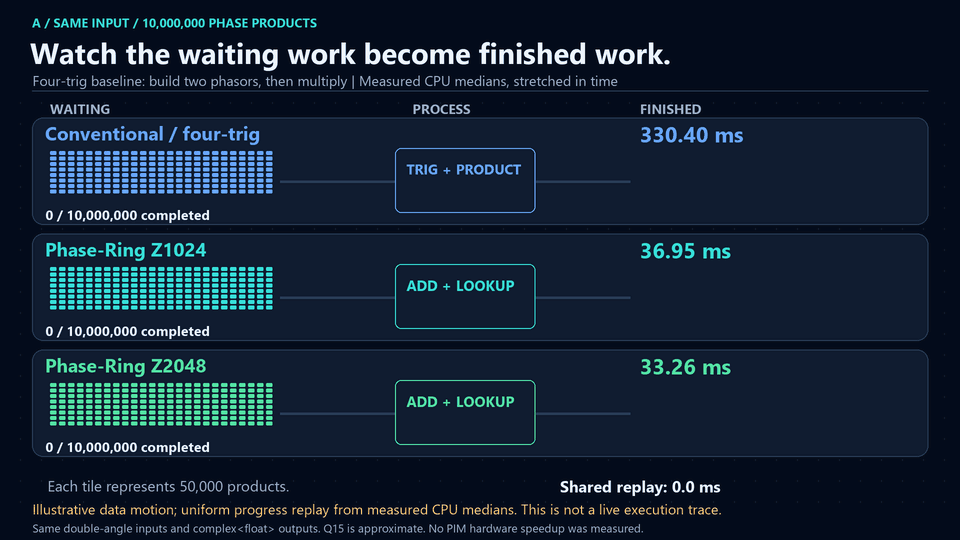
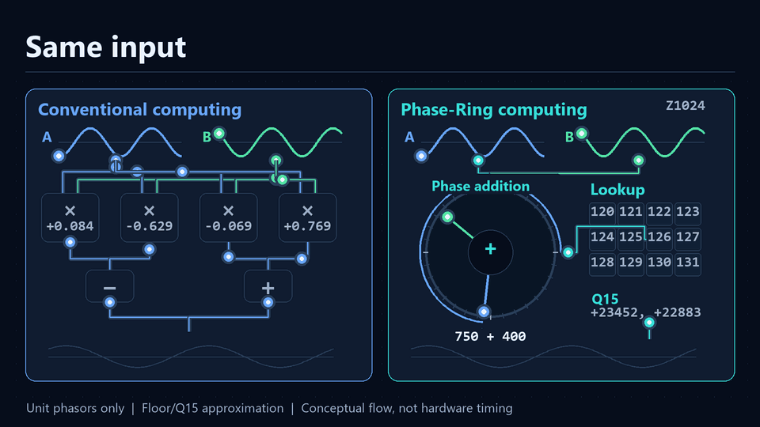
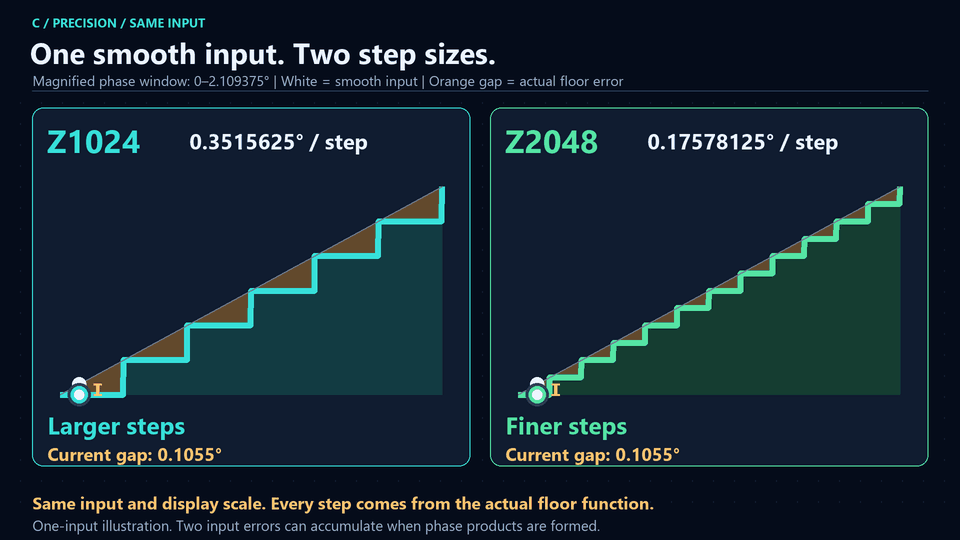
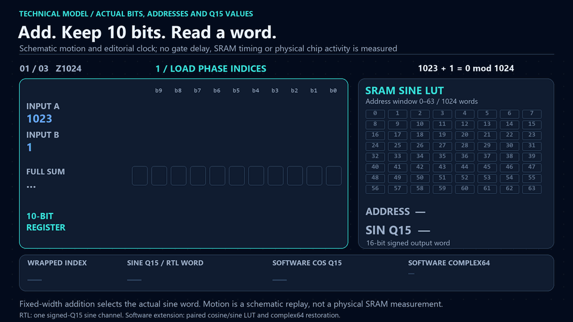
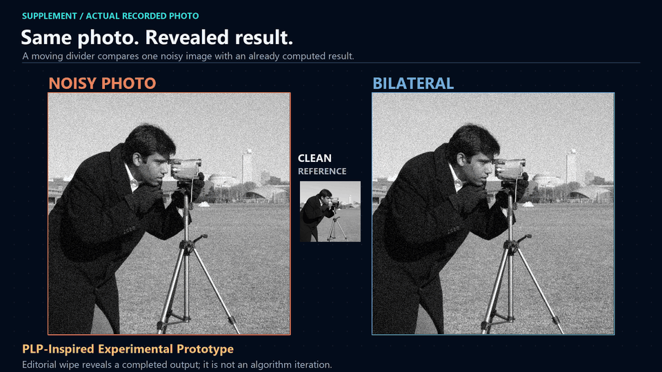

# Phase-Ring PIM & PLP Engine

Watch the same phase task take two routes: conventional arithmetic, or phase addition and a lookup. Large moving work queues, turning phase dials, and visible quantization steps explain the difference. The animations use real CPU measurements and executable arithmetic; they do not demonstrate a physical PIM chip.



**Same task. Different computing approach.** Watch the [40-second introduction / 1080p MP4](animations/video/project_overview.mp4). This GIF is a 12-second edited preview of the four core scenes. [Overview renderer](scripts/render_public_visuals.py) · [Poster](results/public_visuals/project_overview_poster.png) · [Evidence and presentation guide](docs/public_visuals.md)

## 1. See the work finish


Each lane starts with the same 10 million phase products. Tiles leave the waiting queue, pass through an illustrative processor and collect as finished work; one common linear replay clock follows the stored median times.

| Same 10M unit-phase products | CPU median | Angular RMSE |
| --- | --- | --- |
| Build two phasors, then multiply (four-trig) | 330.40 ms | 2.57e-08 rad |
| Add angles, then reconstruct (optimized) | 195.61 ms | 1.19e-08 rad |
| Phase-Ring Z1024 / Q15 lookup | 36.95 ms | 0.006617 rad |
| Phase-Ring Z2048 / Q15 lookup | 33.26 ms | 0.003311 rad |

Z1024 / Z2048 have **8.94x / 9.93x shorter median runtime than the four-trig baseline**, or **5.29x / 5.88x than the optimized angle-sum baseline**. This specific C++ CPU workload uses float64 angles and complex<float> output, with approximation in the Q15 branches. The data motion and uniform completion counters are editorial replay, not instrumented execution; playback is stretched far beyond actual milliseconds.

[MP4](animations/video/public_cpu_workflow.mp4) · [Motion code](scripts/visualize_workflow_v5.py) · [Benchmark code](native/audit_benchmark.cpp) · [Measured data](results/native_audit_benchmark.csv) · [Raw repeats](results/native_audit_samples.csv) · [Accuracy](results/native_audit_accuracy.csv) · [Full native audit](docs/native_audit.md)

## 2. See a different arithmetic route



Two shared unit-magnitude phase inputs travel through two different diagrams: four real products and two combinations, or a quantized phase dial, modular addition and a lookup. The output waves nearly coincide, while their actual angular difference remains visible. Equal editorial pacing is not a measured count of hardware cycles, and the identity does not cover arbitrary FP32 multiplication or general MACs.

[MP4](animations/video/public_phase_computing.mp4) · [Renderer](scripts/visualize_public_principle.py) · [Arithmetic model](src/phase_ring/__init__.py) · [Reference examples](results/reference_vectors.csv) · [Source alignment](docs/source_alignment.md)

## 3. See the precision steps



A smooth white input meets coarse Z1024 steps and finer Z2048 steps in the same magnified phase window. Their bin widths are **0.3515625° / 0.17578125°**; all steps and orange gaps come from the actual floor quantizer. The final product-error comparison uses recorded two-input RMSE; two input quantization errors can accumulate, and better resolution does not guarantee shorter runtime.

[MP4](animations/video/public_phase_precision.mp4) · [Renderer](scripts/visualize_public_precision.py) · [Quantizer](src/phase_ring/__init__.py) · [Recorded sweep](results/precision_sweep.csv) · [Product-error data](results/native_audit_accuracy.csv)

## 4. Follow the actual bits into the LUT



The technical scene follows actual bit carries, register width and selected LUT words for **1023 + 1 → 0**, **750 + 400 → 126** in Z1024, and **1500 + 800 → 252** in Z2048. The diagram distinguishes the RTL scalar-sine table from the software paired cosine/sine extension. This is a logical schematic with editorial timing, not a measurement inside physical SRAM.

[MP4](animations/video/phase_bits_to_lut.mp4) · [Renderer](scripts/visualize_bit_lut_v5.py) · [RTL](hardware/phase_adder.v) · [Self-checking RTL bench](hardware/tb_phase_adder.v) · [Reference data](results/reference_vectors.csv) · [Hardware status](docs/hardware.md)

## Research supplement: look at the actual photograph



A large photograph comes first: the slider reveals already computed Bilateral, V1 and V2 outputs from the same noisy image. Shared enlarged crops then inspect small text, thin lines, object edges and dark texture; quality and time appear later. The sliding boundary is an editorial comparison, not an iterative denoising process.

**PLP-Inspired Experimental Prototype — Not a Validated Implementation of the Original PLP Equations**

V1 uses Wiener shrinkage, guided smoothing and 10-bit quantization; V2 removes guided smoothing. Across 54 cases, V2 reduces mean per-case median time **12.41 → 6.08 ms** and increases the custom edge score **0.866 → 0.879**, while mean PSNR falls **34.00 → 32.69 dB** and SSIM falls **0.927 → 0.862**. Bilateral remains in every comparison and is faster than V2 on the suite average. These are tradeoffs, not general PLP superiority; the custom Sobel edge score is not a standardized perceptual metric.

[MP4](animations/video/photo_noise_comparison.mp4) · [Renderer](scripts/visualize_photo_noise.py) · [Filter code](src/plp/__init__.py) · [All cases](results/expanded_noise.csv) · [Recorded image arrays](results/visual_study/camera_outputs.npz) · [Study and metric definitions](docs/visual_study.md) · [Detailed original methodology](docs/methodology.md)

## Reproduce this visual edition

Run from the repository root with Python 3.12. These commands read the committed measurements and add only the new visual-edition artifacts; no benchmark rerun is needed.

```bash
python -m venv .venv
# Windows: .venv/Scripts/Activate.ps1
# Linux/macOS: source .venv/bin/activate
python -m pip install -r requirements.txt
python -m scripts.render_public_visuals --preview-only
python -m scripts.render_public_visuals
python -m scripts.public_gallery
python -m scripts.validate_public_visuals
```

MP4s use 1920×1080 / 24 fps; looping GIFs use 960×540 / nominal 25 fps. Repeated frames may be merged without changing playback timing. The overview MP4 is 40 seconds; its GIF is a shorter 12-second edit. Each standalone animation blends to its first frame over the last 0.8 seconds. [Frame reviews](results/public_visuals) · [New validation record](results/public_visuals/validation.json) · [Preserved-file evidence](results/public_visuals/preservation.json)

### Separate experiment scopes

- **A. NumPy CPU:** the earlier separate-array workload, including allocation and conversion. Integer-kernel output is an index; FP32-kernel output is complex, so those kernels do not represent equivalent full pipelines. [Measurements](docs/measurements.md), [CSV](results/benchmark.csv), [raw repeats](results/timing_samples.csv), [environment](results/environment.json).
- **B. Native C++ CPU:** fused preallocated loops and a separate input dataset; no fast-math. The optimized angle-sum and quantized float-LUT controls expose implementation dependence. A separate repeat reversed Z1024/Z2048 runtime ranking; the gallery uses one disclosed run, not a mix. [Audit](docs/native_audit.md), [original method](docs/native_benchmark.md), [compiler diagnostics](results/native_audit_compiler.json), [environment](results/native_audit_environment.json).
- **C. Mathematical / architectural:** masked modular addition and Q15 lookup implement the paper's finite phase model. Lookup setup is outside the CPU steady-state timing; Q15 restoration is inside. Scalar sine storage is 2/4 KiB, paired int16 complex storage 4/8 KiB. [Source mapping](docs/source_alignment.md).
- **D. Paper-reported estimates:** ~0.015 pJ/op, 270 um² and ~4 FO4 for an adder, plus appended-IX image claims, remain unverified. They are never inserted into measured CPU/image CSVs. [Paper review](docs/paper_review.md).

### Earlier visual editions remain available

All prior code, measurements, images and videos are retained unchanged; only this README is reorganized. Branch `backup/pre-public-visuals-b6fffe6` also preserves the preceding complete edition. Earlier generators remain historical entry points; the commands above build the current gallery.

| Earlier demo | GIF | MP4 |
| --- | --- | --- |
| Native timing and accuracy | [GIF](animations/native_cpp_performance.gif) | [MP4](animations/video/native_cpp_performance.mp4) |
| Computational architecture | [GIF](animations/computing_architecture.gif) | [MP4](animations/video/computing_architecture.mp4) |
| NumPy race | [GIF](animations/benchmark_speed_race.gif) | [MP4](animations/video/benchmark_speed_race.mp4) |
| Phase overflow / LUT | [GIF](animations/phase_overflow_lut.gif) | [MP4](animations/video/phase_overflow_lut.mp4) |
| Precision | [GIF](animations/phase_precision_comparison.gif) | [MP4](animations/video/phase_precision_comparison.mp4) |
| Image-first noise | [GIF](animations/noise_reduction_comparison.gif) | [MP4](animations/video/noise_reduction_comparison.mp4) |
| Edge and latency ablation | [GIF](animations/edge_preservation_comparison.gif) | [MP4](animations/video/edge_preservation_comparison.mp4) |

[Prior presentation review](docs/visual_quality.md) · [Noise revision notes](docs/noise_visual_revision.md) · [Ablation data](results/noise_ablation.csv) · [Prior validation](results/validation.json)

## Paper, implementation and validation limits

The user-designated nine-page Korean translation of Kim Chul's Paper VIII, dated October 1, 2026, is fingerprinted in [source_manifest.json](results/source_manifest.json). VIII occupies pages 1–5; the appended image-processing IX occupies pages 6–9. Original PDFs remain excluded; the source DOI is a placeholder.

The phase identities, floor quantizer, modular wrap and signed-Q15 sine listing are directly reproducible. The paper does not fully specify the discrete PLP potential/entropy/contour/reconstruction operators, so V1/V2 are independent substitutes. No complete PLP image algorithm, prime-orbit erasure, Dirac subpixel recovery, general denoising superiority or super-resolution has been validated. The six grayscale fixtures with clipped Gaussian noise are a limited study. No RTL simulator, synthesis, SRAM macro, FPGA or silicon power/area/timing result is claimed, and CPU speed ratios do not establish PIM energy savings.

[Full source review](docs/paper_review.md) · [RTL status](docs/hardware.md) · [Licensing status](LICENSE) · [Third-party sources and notices](THIRD_PARTY_NOTICES.md)
