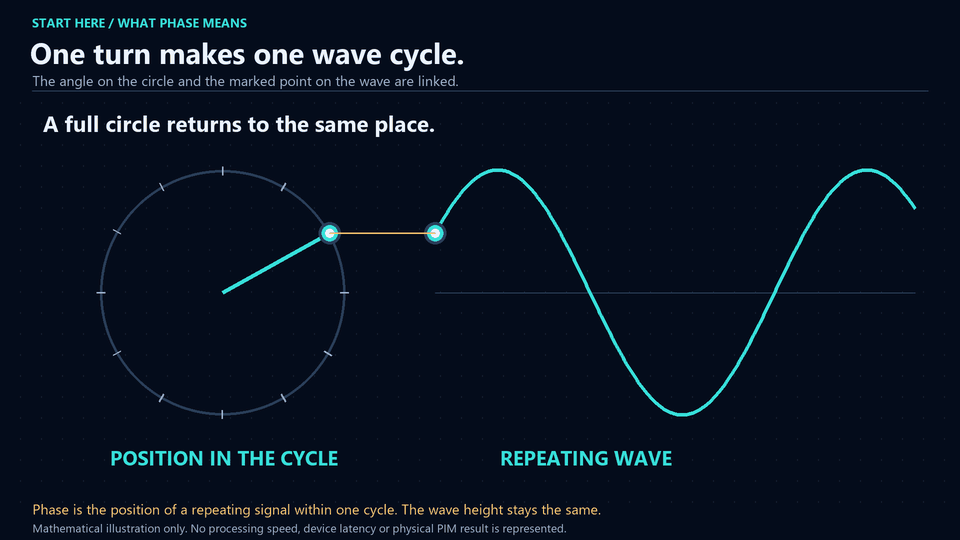
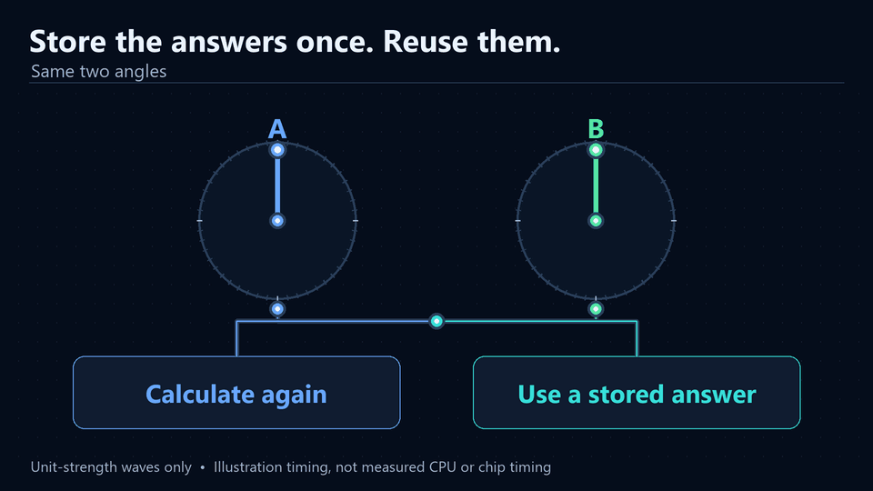
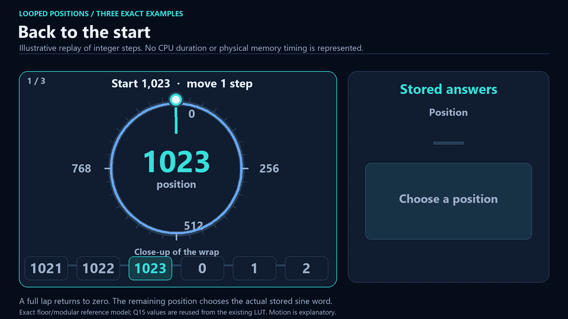
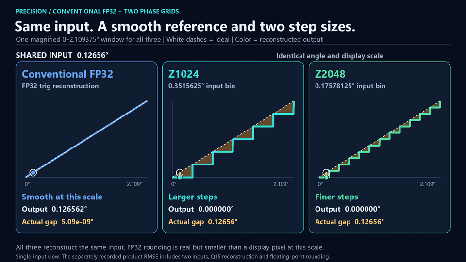
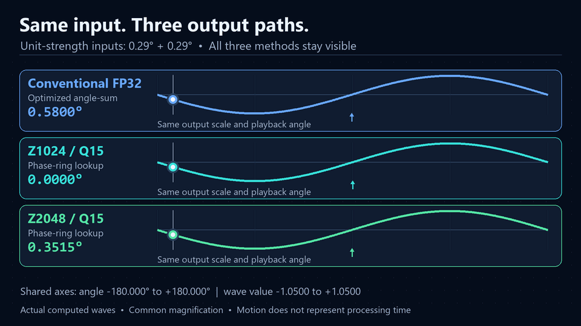
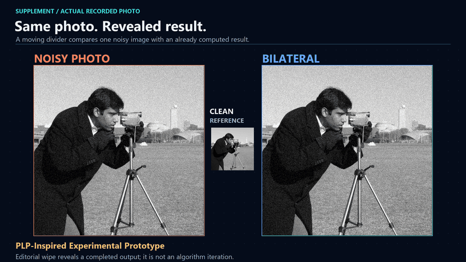
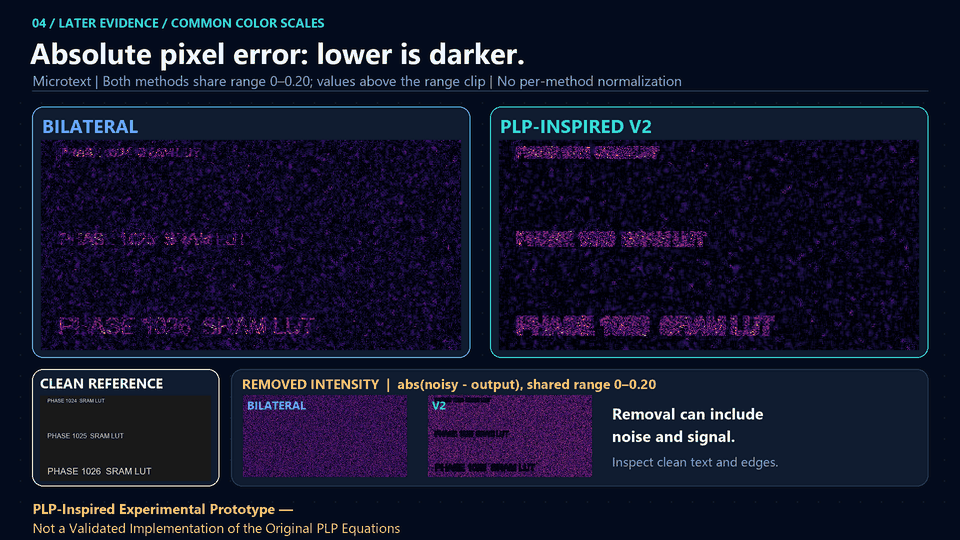
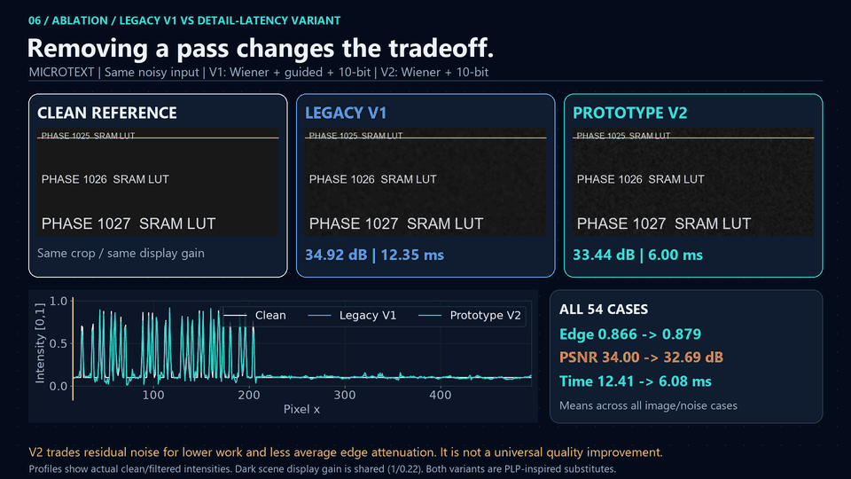

# Phase-Ring PIM & PLP Engine

Two CPU experiments inspired by [Paper VIII](paper/Paper_VIII_Dual_Layer_Topological_Neuromorphic_Architecture.pdf): computing with wave angles, and removing noise from images. Follow each topic below from its result to its explanation.

## Wave-angle calculation

### Processing time

[Watch MP4](animations/video/public_cpu_workflow.mp4)

Each row receives the same inputs for 10 million results. The animation replays recorded CPU medians at a slower pace; it is not a live processing trace.

| Method in this CPU test | Time for 10 million results |
| --- | --- |
| Calculate both input waves, then multiply | 330.40 ms |
| Add the angles, then calculate the output (optimized) | 195.61 ms |
| Read a table with 1,024 positions (Z1024) | 36.95 ms |
| Read a table with 2,048 positions (Z2048) | 33.26 ms |

The optimized conventional route took 5.29 and 5.88 times as long as Z1024 and Z2048 in this run. Those table-based routes return approximate answers. Another run reversed their speed ranking. [Measurement conditions and accuracy](docs/native_audit.md).

### What an angle means for a wave

[Watch MP4](animations/video/phase_wave_basics.mp4)

The circle hand and the marked point on the wave have the same height. The hand's position within one turn is the wave's phase.

### Calculate the answer or read it from a table

[Watch MP4](animations/video/calculate_or_lookup.mp4)

Multiplying two waves of unit strength adds their angles. The conventional route evaluates sine and cosine. The table route numbers positions on a circle, adds the numbers and reads a prepared answer. Z1024 has 1,024 positions; Z2048 has 2,048. FP32 in these comparisons describes the conventional output channels.

### What happens after a full turn

[Watch MP4](animations/video/wrap_and_fetch.mp4)

After the last position comes the first again, as on a clock. The selected position is the address of the stored answer. [Bit-level implementation](docs/hardware.md).

### The precision cost

[Watch MP4](animations/video/curated_phase_precision.mp4)

All three panels use the same input and scale. Z2048 has half the angle spacing of Z1024, so its smaller steps usually follow the input more closely. The stored answers also have limited numerical precision. The conventional rounding error is too small to see at this scale, but is reported numerically.

### How that error changes the output wave

[Watch MP4](animations/video/curated_phase_outputs.mp4)

Here the two input angles are 0.29 degrees each. A common zoom separates the returned waves without enlarging one method more than another. This is an illustration; the measured error distribution uses a separate sample. [Comparison details and recorded errors](docs/conventional_comparison.md).

## Photograph denoising

### Noise removal and remaining detail

[Watch MP4](animations/video/curated_photo_noise.mp4)

Compare speckles in the sky with the tripod edges. Bilateral is a conventional filter. V1 adds an extra smoothing pass; V2 leaves it out. The moving divider reveals completed outputs rather than showing the filtering process.

**PLP-Inspired Experimental Prototype - Not a Validated Implementation of the Original PLP Equations**

### Residual noise and removed detail

[Watch MP4](animations/video/curated_noise_errors.mp4)

The error maps show the difference from the clean reference. Removed-signal maps show what each filter discarded, which can include real image detail. Every output uses the same display scale within each map type.

### The effect of the extra smoothing pass

[Watch MP4](animations/video/edge_preservation_comparison.mp4)

The profiles compare actual pixel intensities across an edge. V2 finishes sooner than V1, but its mean PSNR and SSIM are lower; Bilateral is also faster than V2 on the study average. There is no overall winner established by these tests.

| Filter | Mean PSNR (dB) | Mean SSIM | Mean CPU time (ms) |
| --- | --- | --- | --- |
| Bilateral | 34.14 | 0.821 | 5.28 |
| V1: with extra smoothing | 34.00 | 0.927 | 12.41 |
| V2: without that extra pass | 32.69 | 0.862 | 6.08 |

These are means across 54 noisy cases: six images, three noise levels and three seeds. Higher PSNR and SSIM mean a closer match under those metrics; lower CPU time means faster processing. The clean image is used only for evaluation. [Study methods and all cases](docs/visual_study.md).

### What the wider PLP model proposes

The measured phase-arithmetic results are encouraging for the tested CPU workload. The wider PLP model still needs further research. The paper presents it as a combined mathematical framework for signal and image processing, with a broader intended scope than an individual filter or transform algorithm. This describes the proposal's scope, rather than a demonstrated performance advantage.

PLP means Point-Line-Plane. The paper describes processing in the order Plane → Line → Point:

| Component | Proposed role in the paper |
| --- | --- |
| Plane | Describe variation and noise across an image surface. |
| Line | Select phase relationships along paths and contours. |
| Point | Locate features where the selected structures meet. |

The unified equation combines these components. The paper also uses fixed-point contraction to argue that the reconstructed state converges to a stable feature location. This is the proposed route to a convergence point; the formula by itself does not specify all the steps needed to compute that point from an image. [Source: VIII Eqs. (5)-(6), appendix B-C, pp. 2-3 and 6-8](paper/Paper_VIII_Dual_Layer_Topological_Neuromorphic_Architecture.pdf).

Further work must define those steps, establish the conditions and rate of convergence, and compare a complete implementation with conventional methods. The filters shown above are simplified experimental substitutes, so their results do not yet validate the full point-line-plane model.

## Paper and scope

The [English original](paper/Paper_VIII_Dual_Layer_Topological_Neuromorphic_Architecture.pdf) is included unchanged. Pages 1-5 contain Paper VIII; pages 6-9 contain the signal/image-processing IX appendix. [Source comparison and hash](docs/paper_comparison.md).

The wave-angle timings concern unit-strength complex signals on a CPU. They do not predict image-filter performance or general multiplication speed. No physical PIM chip, energy or area was measured. Zero-blur and super-resolution claims remain unverified. [Paper review](docs/paper_review.md).

## Reproduction and supporting material

[Setup and reproduction](docs/reproduction.md) · [Native CPU data](results/native_audit_benchmark.csv) · [Image data](results/expanded_noise.csv) · [Separate NumPy experiment](docs/measurements.md)

[Alternative and earlier videos](docs/media_archive.md) · [Licensing status](LICENSE) · [Third-party notices](THIRD_PARTY_NOTICES.md)

## Paper and author

Paper VIII - Zenodo: [10.5281/zenodo.22782241](https://doi.org/10.5281/zenodo.22782241)

Author email: [voodoo6000@daum.net](mailto:voodoo6000@daum.net)
