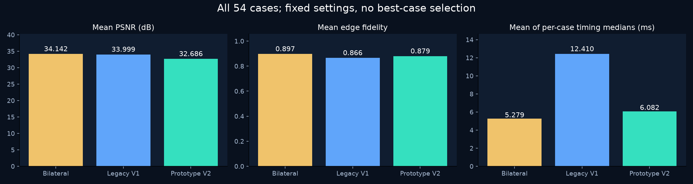

# Phase-Ring PIM & PLP Engine

**Watch unit-phase multiplication become modular addition, bit truncation and an addressed LUT read.**

Executable CPU models and honest measurements inspired by Paper VIII. The circuit views are conceptual; the denoisers are explicitly experimental. No fabricated PIM chip is demonstrated.

### Add -> overflow -> memory address


**Direct arithmetic reproduction.** A rotating phase dial, 10/11-bit registers and a selected LUT word stay linked across all three required rollover examples.

### The same inputs take different paths


**Conceptual circuit animation with real values.** Both branches restore complex output; paired Q15 lookup and quantization are explicit. Editorial pacing and block count do not imply a speed advantage.

### Race the measured CPU paths


**Independently measured results.** Four workload sizes, two distinct scopes: arithmetic kernels first, then the full raw-angle-to-complex pipeline. Slower ring results are retained.

## Demo gallery

| Demo | Watch GIF | 1080p H.264 | Evidence / code / data |
| --- | --- | --- | --- |
| Computational architecture | [GIF](animations/computing_architecture.gif) | [MP4](animations/video/computing_architecture.mp4) | Conceptual dataflow + real numerical example; [code](src/phase_ring/__init__.py), [data](results/reference_vectors.csv) |
| Real CPU speed race | [GIF](animations/benchmark_speed_race.gif) | [MP4](animations/video/benchmark_speed_race.mp4) | Measured NumPy medians; kernel and full pipeline; [code](src/benchmark/run.py), [data](results/benchmark.csv) |
| Phase overflow and SRAM LUT | [GIF](animations/phase_overflow_lut.gif) | [MP4](animations/video/phase_overflow_lut.mp4) | Bit-exact modular arithmetic and Q15 lookup; [code](hardware/phase_adder.v), [data](results/reference_vectors.csv) |
| Noise reduction and error maps | [GIF](animations/noise_reduction_comparison.gif) | [MP4](animations/video/noise_reduction_comparison.mp4) | Experimental prototype; common-scale errors; [code](src/benchmark/visual_study.py), [data](results/expanded_noise.csv) |
| Quantization and precision | [GIF](animations/phase_precision_comparison.gif) | [MP4](animations/video/phase_precision_comparison.mp4) | Real floor quantization and complex64 reference; [code](src/phase_ring/__init__.py), [data](results/precision_sweep.csv) |
| Edge preservation and ablation | [GIF](animations/edge_preservation_comparison.gif) | [MP4](animations/video/edge_preservation_comparison.mp4) | Legacy V1 versus detail/latency V2; [code](src/plp/__init__.py), [data](results/noise_ablation.csv) |

All six masters are 1920x1080, H.264, 24 fps and 12 seconds. GIFs are 960x540, looping at a nominal 12.5 fps. The three hero GIFs total approximately 2.76 MB. [Shared animation renderer](scripts/visualize_v3.py) · [Presentation semantics and quality review](docs/visual_quality.md).

### See the precision cost


A 4-degree window magnifies the true floor-quantization steps. Z1024 resolves 0.3515625 degrees per bin; Z2048 resolves 0.17578125. The orange gaps are actual floor error. Measured product RMSE is reported separately from this single-input illustration.

### Image processing: a research supplement

The image demos compare Clean Original, Noisy Input, Bilateral and a **PLP-Inspired Experimental Prototype - Not a Validated Implementation of the Original PLP Equations**. They use synchronized zooms, actual pixel/edge errors, true profiles and measured processing time. They are kept out of the hero section because this study does not establish general denoising superiority.

[Noise GIF](animations/noise_reduction_comparison.gif) / [MP4](animations/video/noise_reduction_comparison.mp4) · [Ablation GIF](animations/edge_preservation_comparison.gif) / [MP4](animations/video/edge_preservation_comparison.mp4)



Legacy V1 remains available unchanged. V2 removes its second spatial smoothing pass: mean edge fidelity and runtime improve, while mean PSNR and SSIM decline. This is an exposed tradeoff, not a universal quality improvement. The fixed microtext example has V2-minus-Bilateral PSNR **-0.274 dB**, ranking **34/54** in ascending gain. It was declared before quality comparison, not selected as the best case. [Full image study and ablation](docs/visual_study.md).

## Independently measured CPU results

At 10,000,000 products on 12th Gen Intel(R) Core(TM) i5-12400, NumPy 2.5.4, two warm-ups and seven repetitions:

| Method | Kernel only (ms) | End-to-end (ms) |
| --- | --- | --- |
| FP32 | 26.707 | 765.735 |
| Z1024 | 15.851 | 683.486 |
| Z2048 | 15.061 | 695.404 |

**Kernel outputs differ:** FP32 returns complex values, integer addition returns indices. With common pre-encoded complex output at 10,000,000, FP32 takes **26.71 ms**, Z1024 + LUT **231.04 ms**. Full-pipeline timings include input conversion, quantization, LUT lookup and restoration. These CPU results do not validate hardware energy, area or in-memory performance.

A separate optimized C++ run is included: at 10M products its raw-angle medians are FP32 **375.66 ms**, Z1024 **42.00 ms**, Z2048 **39.26 ms**. Native loops are fused and preallocated, so these numbers cannot be attributed to language alone. [Native method and reproduction](docs/native_benchmark.md).

[All sizes, dispersion, throughput, memory and accuracy](docs/measurements.md) · [NumPy environment](results/environment.json) · [Raw samples](results/timing_samples.csv)

## Implementation and evidence boundaries

- **Paper implementations / faithful arithmetic:** Eq. (1)-(4), 10/11-bit masked addition, Listing 2 signed-Q15 sine LUT, adapted Listing 1 RTL with deterministic memory initialization. All modular input pairs are checked in software.
- **Independent experimental design:** V1 local Wiener + guided smoothing + intensity quantization; V2 local Wiener + intensity quantization. Neither implements the PLP master equation, prime-orbit erasure, entropy absorption or Dirac sub-pixel recovery.
- **Paper-Reported Estimates:** approximately 0.015 pJ/op and 270 um^2 for a 10-bit adder (VIII Table I); 48.6 dB PSNR, 0.993 SSIM and 0.036 pJ/pixel (appended IX Table II). No independent implementation evidence for those hardware/image claims was supplied. They never populate the measured CSV files.

[Source-to-code alignment](docs/source_alignment.md) · [Full paper review](docs/paper_review.md) · [Missing PLP definitions and image-study limits](docs/visual_study.md) · [RTL status](docs/hardware.md)

## Reproduce

Use Python 3.12. Commands below run from the repository root. A full run writes new current results; preserved measurements remain under `results/archive/pre-v3-db8bbe5/` and in the backup branch.

```bash
python -m venv .venv
# Windows: .venv/Scripts/Activate.ps1
# Linux/macOS: source .venv/bin/activate
python -m pip install -r requirements.txt
python scripts/reproduce.py
```

```bash
# Optional fused native CPU benchmark:
python -m pip install -r requirements-native.txt
python scripts/reproduce.py --native

# Reuse measurements and rebuild all six animations:
python scripts/reproduce.py --skip-benchmark

# Quick compute sizes / 3 repetitions; expanded image suite retained:
python scripts/reproduce.py --quick

python -m unittest discover -s tests -v
python -m scripts.validate_v3
python scripts/verify_source.py /path/to/reference.pdf
```

The normal NumPy/expanded-image reproduction does not require a compiler. Native measurements are a separately requested step. First example-data access may require internet. Cross-platform fonts may alter generated text fixtures; committed clean images and fixture hashes identify the supplied run. [Methodology](docs/methodology.md), [image experiment](docs/visual_study.md), [native experiment](docs/native_benchmark.md).

## Source, limitations and next steps

The user-designated nine-page Korean translation of Kim Chul's Paper VIII, dated October 1, 2026, is fingerprinted in [source_manifest.json](results/source_manifest.json). VIII is pages 1-5; the appended IX signal/image-processing paper is pages 6-9. The separate English edition is dated September 16, 2026. Original PDFs are excluded.

The paper's unspecified discrete PLP estimator prevents a faithful full image implementation. CPU benchmarks do not validate a physical PIM architecture. The supplied RTL bench has not been run; no synthesis, FPGA or silicon power/area/timing result is claimed. The expanded study is six grayscale images with clipped additive Gaussian noise, not general video/RAW/super-resolution validation. The source archive DOI is a placeholder.

Next: obtain the complete discrete PLP algorithm and source experiments, expand independently licensed images/noise models, run documented RTL/synthesis and memory-macro validation, then measure physical system energy. Project-wide license selection remains pending. [LICENSE](LICENSE) · [Third-party notices](THIRD_PARTY_NOTICES.md).
