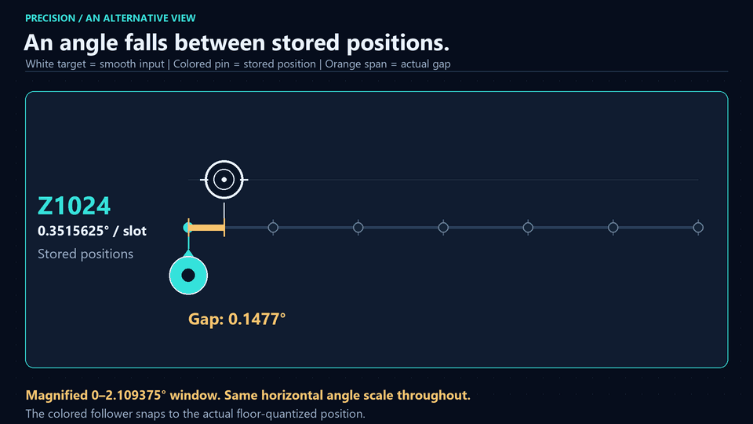
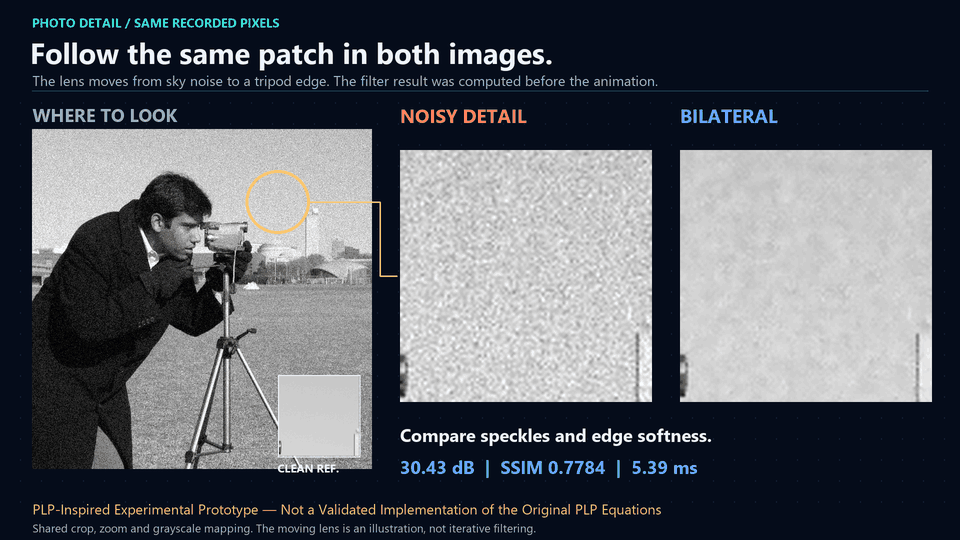
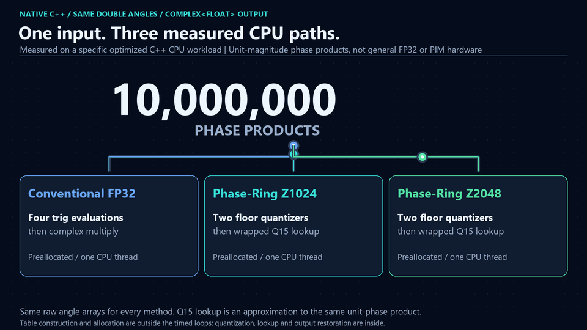
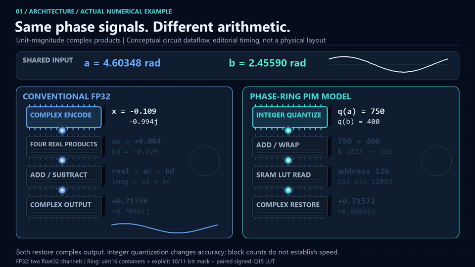
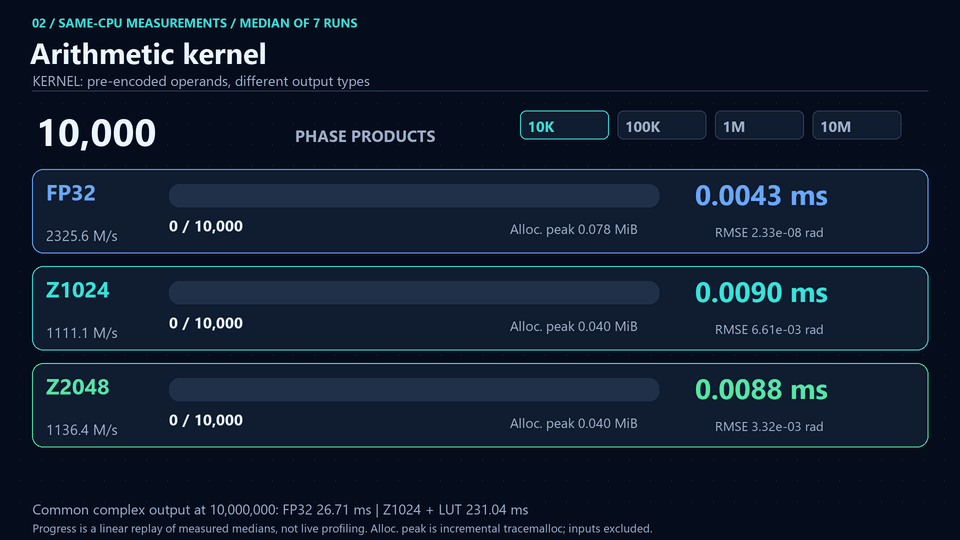
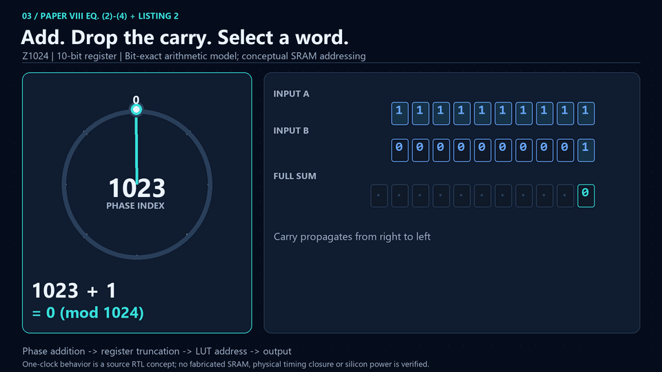
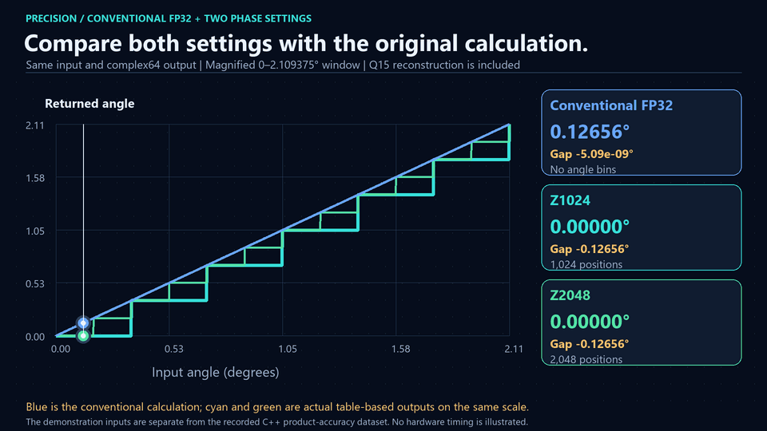
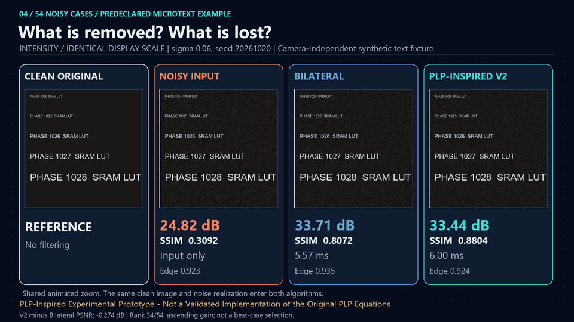

# Phase-Ring PIM & PLP Engine

This repository runs two CPU experiments inspired by [Paper VIII](paper/Paper_VIII_Dual_Layer_Topological_Neuromorphic_Architecture.pdf). One tests whether a stored table can replace repeated calculations for wave angles. The other compares filters that remove speckles from an image. The speed figures from the first experiment do not describe the image filters, and neither experiment tests a physical PIM chip.

## Calculation time


Each row receives the same input for 10 million results. The blocks show equal amounts of work moving into the finished area. Their timing follows recorded CPU medians, slowed down for the video; the moving blocks are an illustration.

| Method in this CPU test | Time for 10 million results |
| --- | --- |
| Calculate both input waves, then multiply (four sine/cosine evaluations) | 330.40 ms |
| Add the angles, then calculate the output (optimized) | 195.61 ms |
| Use a stored table with 1,024 positions (Z1024) | 36.95 ms |
| Use a stored table with 2,048 positions (Z2048) | 33.26 ms |

Calculating both input waves before multiplying took **8.94 / 9.93 times as long as Z1024 / Z2048** in this run. The optimized formula route took **5.29 / 5.88 times as long**, respectively. The table-based paths return an approximate answer. This applies to a particular task involving angles of unit-strength waves, not all multiplication. Another run reversed the speed ranking of Z1024 and Z2048.

[Watch MP4](animations/video/public_cpu_workflow.mp4) · [Measurement conditions](docs/native_audit.md) · [Data](results/native_audit_benchmark.csv)

## Removing noise from a photograph


Look at the speckles in the sky and coat, then at the tripod edges and the enlarged details. A filter can remove speckles and also soften real detail. The divider reveals an already completed result; it does not show the algorithm processing the picture step by step.

The video compares a standard Bilateral filter with two experimental filters. V1 adds a smoothing pass after local noise reduction. V2 leaves out that pass: it finishes sooner than V1, but its average PSNR and SSIM are lower. Bilateral is also faster than V2 on the full study average. There is no overall winner established by these tests.

**PLP-Inspired Experimental Prototype — Not a Validated Implementation of the Original PLP Equations**

[Watch MP4](animations/video/photo_noise_comparison.mp4) · [Image-study methods](docs/visual_study.md) · [All cases](results/expanded_noise.csv)

<details>
<summary>Photo quality and processing times</summary>

These are means across 54 noisy cases: six images, three noise levels and three seeds. PSNR and SSIM compare each output with the clean reference; higher values mean a closer match under these metrics. CPU time is the mean of per-case timing medians; lower is faster. The clean reference is used for evaluation, not given to the filters.

| Filter | Mean PSNR (dB) | Mean SSIM | Mean CPU time (ms) |
| --- | --- | --- | --- |
| Bilateral | 34.14 | 0.821 | 5.28 |
| V1: with extra smoothing | 34.00 | 0.927 | 12.41 |
| V2: without that extra pass | 32.69 | 0.862 | 6.08 |

The study also records a custom edge score. V2 raises that mean score from 0.866 to 0.879 compared with V1, while losing PSNR and SSIM. That score is not a standard perceptual quality measure. [Definitions and limitations](docs/methodology.md) · [Filter code](src/plp/__init__.py)

</details>

## More ways to understand the same idea

These are additional versions. Start with the circle and wave, then follow the stored-answer shortcut, angle error, wrapping and photo details. The earlier videos remain visible farther down this page.

### A turn on a circle becomes a wave


The moving circle hand and the marked wave point always have the same height. This introduces phase before any computation.

[MP4](animations/video/phase_wave_basics.mp4) · [GIF](animations/phase_wave_basics.gif)

### Calculate again or fetch a stored answer


Two shared angles take different routes: calculate the result, or add numbered positions and select a prepared answer.

[MP4](animations/video/calculate_or_lookup.mp4) · [GIF](animations/calculate_or_lookup.gif)

### A moving target between stored positions



A white target moves smoothly while colored pins snap down to real stored angles. The gap is shown at one shared magnification.

[MP4](animations/video/angle_snap_targets.mp4) · [GIF](animations/angle_snap_targets.gif)

### Back to the start, then read an answer


A token passes the last position on the ring and returns to the beginning. Its actual final position selects the stored sine value.

[MP4](animations/video/wrap_and_fetch.mp4) · [GIF](animations/wrap_and_fetch.gif)

### A moving lens over real photo details



The lens visits the same sky and tripod pixels in noisy and filtered images. The displayed filter outputs are already complete.

[MP4](animations/video/noise_detail_lens.mp4) · [GIF](animations/noise_detail_lens.gif)

[New renderers and reproduction](docs/story_variants.md) · [All preserved measurements](docs/measurements.md)

## The earlier explanation versions

These versions show the same topics with more numerical or technical detail. They remain embedded here alongside the simpler versions.


**How the calculation changes.** Picture an angle as the position of a hand on a clock. The blue path calculates the waves and multiplies them. The cyan path adds their numbered positions and reads an answer from a stored table. The final waves are close, but not exactly equal; the actual difference is reported as a number. [Animation](animations/public_phase_computing.gif) · [MP4](animations/video/public_phase_computing.mp4)


**What precision the shortcut loses.** A table has a fixed number of positions. Z1024 has 1,024 marks around the circle; Z2048 has twice as many. The staircase shows an input snapping down to a stored angle, or staying there if it is already on a mark. Smaller steps reduce the angle error and require more table entries. This scene is about accuracy, not speed. [Animation](animations/public_phase_precision.gif) · [MP4](animations/video/public_phase_precision.mp4)


**Whether the bits select the right answer.** Going past the last mark returns to the start, as on a clock face. The program numbers its 1,024 marks from 0: after 1023 comes 0. The bit video checks that wraparound, the table address and the stored value. It checks the implementation; it is not another acceleration claim. [Technical animation](animations/phase_bits_to_lut.gif) · [MP4](animations/video/phase_bits_to_lut.mp4)


[A short guide to these demos](docs/understanding_the_demos.md) · [All four calculation scenes in a 40-second video](animations/video/project_overview.mp4)

## Paper and scope

The [English original](paper/Paper_VIII_Dual_Layer_Topological_Neuromorphic_Architecture.pdf), dated September 16, 2026, is included unchanged at the owner's request. It contains Paper VIII on pages 1-5 and the signal/image-processing IX appendix on pages 6-9. It has the same reviewed equations, code and table values as the earlier October 1 Korean translation, with different dates and pagination. The translation is not included. [Comparison record](docs/paper_comparison.md) · [Source hash](results/source_manifest.json)

The masked phase addition and signed-16-bit lookup table are implemented. The image filters are independently designed substitutes: the source does not define enough discrete steps to reproduce the complete PLP image algorithm. The paper's energy, chip area, zero-blur and super-resolution claims have not been validated here. No RTL simulation, synthesis, SRAM chip, FPGA or silicon measurement is reported. [Paper review](docs/paper_review.md) · [Source-to-code mapping](docs/source_alignment.md) · [Hardware status](docs/hardware.md)

## Code, data and reproduction

```bash
python -m venv .venv
# Windows: .venv/Scripts/Activate.ps1
# Linux/macOS: source .venv/bin/activate
python -m pip install -r requirements.txt
python -m scripts.render_public_visuals --preview-only
python -m scripts.render_story_variants --preview-only
python -m scripts.public_gallery
python -m scripts.validate_public_visuals
python -m scripts.validate_reader_update
python -m scripts.validate_story_variants
```

To regenerate these GIF/MP4 files from the committed data, run `python -m scripts.render_public_visuals` and `python -m scripts.render_story_variants`. They read existing measurements and completed image outputs; they do not collect new benchmark data. MP4s are 1920×1080 at 24 fps; GIFs are 960×540 with playback rates recorded by edition. The new angle stories use 25 fps GIFs, and the photo lens uses 20 fps. Rendering sources and review frames are linked below.

<details>
<summary>Experiment details and rendering sources</summary>

- **NumPy CPU study:** separate array operations, allocation and input conversion. Its integer-add kernel returns an index; the FP32 kernel returns complex values. Those kernels are not equivalent full pipelines. [Measurements](docs/measurements.md) · [CSV](results/benchmark.csv) · [Raw timings](results/timing_samples.csv) · [Environment](results/environment.json)
- **Native C++ study:** fused preallocated loops, float64 input angles and complex<float> output. Tables are built before timing; lookup and Q15 restoration are inside timing. Different accuracy, data generation and allocation policies prevent a language-only speedup claim. [Audit](docs/native_audit.md) · [Original native method](docs/native_benchmark.md) · [Raw timings](results/native_audit_samples.csv) · [Accuracy](results/native_audit_accuracy.csv) · [Compiler inspection](results/native_audit_compiler.json) · [Environment](results/native_audit_environment.json)
- **Phase arithmetic:** the identity applies to unit-magnitude complex signals. Scalar sine storage is 2/4 KiB; the software paired cosine/sine table is 4/8 KiB. [Model](src/phase_ring/__init__.py) · [Reference examples](results/reference_vectors.csv)
- **Image filters:** six grayscale fixtures with clipped Gaussian noise. V1/V2 do not implement the PLP master equation, prime-orbit erasure or Dirac sub-pixel recovery. [Study](docs/visual_study.md) · [Ablations](results/noise_ablation.csv) · [Recorded photo arrays](results/visual_study/camera_outputs.npz)
- **Paper estimates:** approximately 0.015 pJ/op, 270 um² and 4 FO4, plus the IX image claims, are paper-reported values. They are separate from the measured CSVs. [Review](docs/paper_review.md)
- **Renderers:** [Work queues](scripts/visualize_workflow_v5.py) · [Calculation routes](scripts/visualize_public_principle.py) · [Precision](scripts/visualize_public_precision.py) · [Bits and lookup](scripts/visualize_bit_lut_v5.py) · [Photo comparison](scripts/visualize_photo_noise.py) · [Video export](scripts/render_public_visuals.py)

[Frame reviews](results/public_visuals) · [Video validation](results/public_visuals/validation.json) · [Paper and document checks](results/reader_review.json) · [Presentation notes](docs/public_visuals.md) · [Licensing status](LICENSE) · [Third-party notices](THIRD_PARTY_NOTICES.md)

</details>

## More existing versions

All earlier GIFs remain embedded below. No video has been removed or replaced.

### Native timing and accuracy



The earlier native CPU race includes both formula baselines and the measured approximation errors.

[MP4](animations/video/native_cpp_performance.mp4) · [GIF](animations/native_cpp_performance.gif)

### Detailed computational architecture



The shared inputs travel through complex arithmetic or quantization, addition and a paired lookup.

[MP4](animations/video/computing_architecture.mp4) · [GIF](animations/computing_architecture.gif)

### NumPy CPU race



The separate NumPy experiment shows kernel and full-pipeline timings. Kernel output types differ; see its scope labels.

[MP4](animations/video/benchmark_speed_race.mp4) · [GIF](animations/benchmark_speed_race.gif)

### Overflow and addressed memory



A phase dial, register carry and selected lookup word remain linked through the rollover examples.

[MP4](animations/video/phase_overflow_lut.mp4) · [GIF](animations/phase_overflow_lut.gif)

### Precision as actual stair steps



This earlier view uses an angle plot to show floor quantization in a magnified four-degree window.

[MP4](animations/video/phase_precision_comparison.mp4) · [GIF](animations/phase_precision_comparison.gif)

### Text, edges and image errors



The recorded text/edge comparison adds common-scale error maps after actual image views.

[MP4](animations/video/noise_reduction_comparison.mp4) · [GIF](animations/noise_reduction_comparison.gif)

### Noise quality and edge tradeoffs


Actual V1/V2 profiles expose detail attenuation, residual noise and processing-time differences.

[MP4](animations/video/edge_preservation_comparison.mp4) · [GIF](animations/edge_preservation_comparison.gif)

### First arithmetic demonstration


The first edition combines rollover examples with measured CPU scopes. It remains available for comparison.

[MP4](animations/video/computing_comparison.mp4) · [GIF](animations/computing_comparison.gif)

### First image-stage demonstration


The first edition tours the recorded local shrinkage, guided smoothing and final quantization stages.

[MP4](animations/video/noise_comparison.mp4) · [GIF](animations/noise_comparison.gif)

[Previous visual review](docs/visual_quality.md) · [Noise revision](docs/noise_visual_revision.md) · [Previous validation](results/validation.json) · [Source manifest before the English upload](results/archive/source_manifest_viii_ko.json)

## Paper and author

Paper VIII — Zenodo: [10.5281/zenodo.22782241](https://doi.org/10.5281/zenodo.22782241)

Author email: [voodoo6000@daum.net](mailto:voodoo6000@daum.net)
