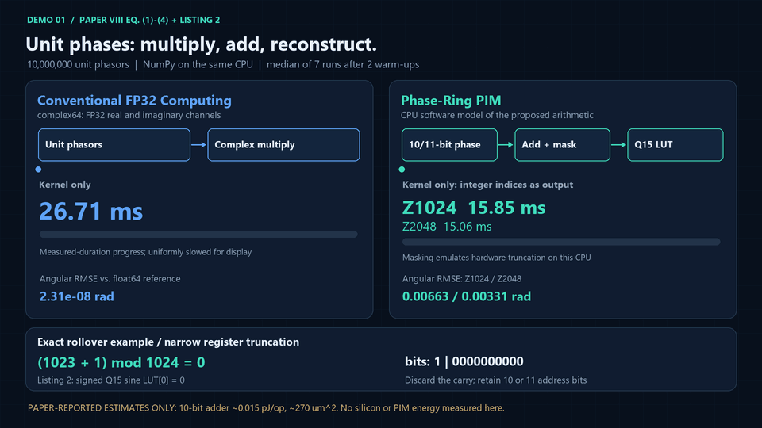
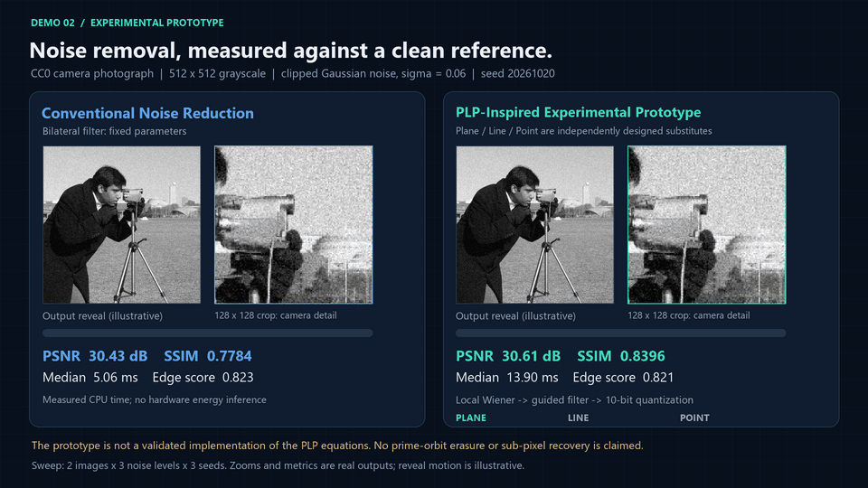
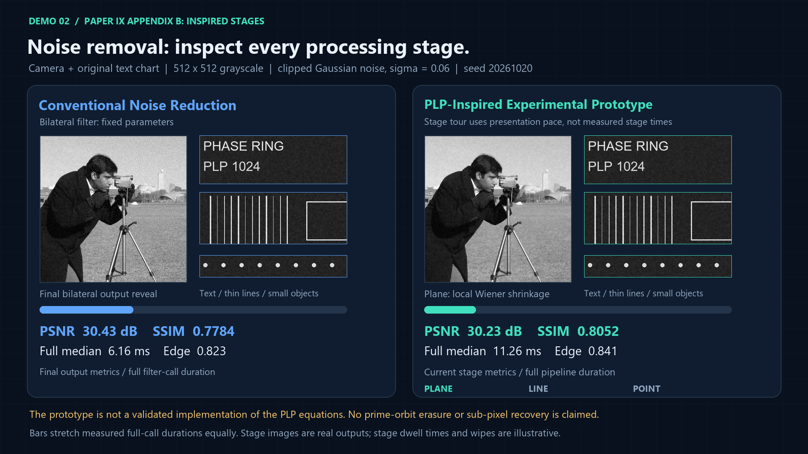
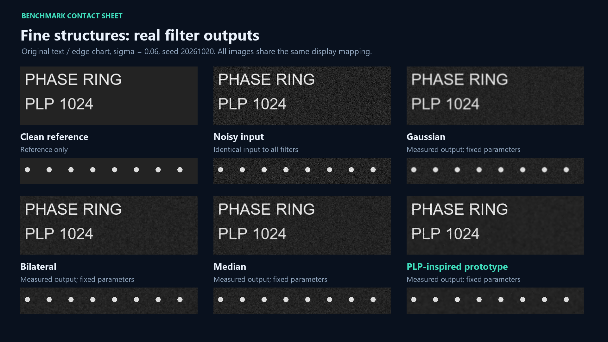

# Phase-Ring PIM & PLP Engine
### Computational Performance and Signal Processing Visualization

A reproducible CPU study of Paper VIII's modular phase arithmetic, with an explicitly experimental image-processing prototype inspired by its Plane-Line-Point structure. Actual measurements, paper estimates, and prototype results remain separate. **This repository does not demonstrate fabricated PIM hardware or a complete implementation of the PLP master equation.**





[1080p compute MP4](animations/video/computing_comparison.mp4) | [1080p noise MP4](animations/video/noise_comparison.mp4) | [Full methodology](docs/methodology.md) | [Source alignment](docs/source_alignment.md) | [Critical paper review](docs/paper_review.md)

## 1. Project Overview

The project implements Z1024/Z2048 masked addition, signed-Q15 LUT lookup, complex64 unit-phasor multiplication, a fair comparison including input conversion and output reconstruction, and Gaussian/Bilateral/Median image baselines. It produces two looping GIFs, two 1920x1080 MP4 masters, raw timing samples, image outputs, accuracy measurements, and English technical documentation.

## 2. Research Background

The user-designated reference is the nine-page Korean translation of Kim Chul's Paper VIII dated October 1, 2026. Its SHA-256 matches the primary source used in the initial implementation; source selection is now confirmed. Pages 1-5 contain VIII; pages 6-9 append Paper IX on PLP signal/image processing. The separate September 16 English edition and a different standalone Paper IX were also reviewed. [Source alignment](docs/source_alignment.md) maps equations and listings to code, tests and evidence categories. [The review](docs/paper_review.md) records source hashes, section-level analysis and evidence gaps. Original research PDFs are intentionally excluded.

Three evidence categories are used throughout:

- **Paper-Reported Estimates:** claims such as 0.015 pJ/op and 270 um^2 for a 10-bit adder; not measured here.
- **Independently Measured Results:** actual CPU timings and numerical/conventional-filter outputs from this code.
- **Experimental Prototype Results:** actual outputs of an independently designed PLP-inspired denoiser; not validation of the paper's operators.

## 3. Phase-Ring PIM Architecture

For unit-magnitude complex signals, `exp(i*a)*exp(i*b) = exp(i*(a+b))`. The implemented quantizer is `q(a)=floor(N*a/(2*pi)) mod N`, followed by `(q(a)+q(b)) & (N-1)` for N=1024 or 2048. It emulates 10/11-bit hardware truncation in a uint16 CPU array. The name PIM identifies the proposed architecture; this execution takes place on a conventional CPU.

The paper's scalar 16-bit sine LUT is 2 KiB for Z1024 or 4 KiB for Z2048. Complex output reconstruction uses both sine and cosine, requiring 4 KiB or 8 KiB in this implementation. LUT construction is outside steady-state timing and measured separately. An adapted parameterized RTL module, deterministic LUT files, and a self-checking testbench are included under `hardware/`. The source RTL did not initialize its memory; the adaptation explicitly does so.

## 4. Conventional Computing vs. Phase-Ring

The experiment is restricted to elementwise unit-phasor products. Complex64 is two FP32 channels. Integer addition outputs an index, while the FP32 kernel outputs a complex number. A kernel-only ratio therefore does not establish equivalent-task or hardware speedup. The encoded-to-complex and full end-to-end comparisons expose conversion and LUT costs. General real-valued multiplication, accumulation, neural inference and arbitrary MAC replacement are outside scope.

## 5. DEMO 01 - Computational Performance Comparison

The blue and teal paths show the operation structures and median timings on the same CPU. Three exact rollover examples show carry-bit truncation and actual signed-Q15 LUT values from Listing 2. Progress uses a common linear time stretch of actual kernel durations; arrows are explanatory rather than instruction traces. Both Z1024 and Z2048 timings and accuracy are shown. Q15 reconstruction and raw-angle pipelines are visible alongside kernel results, including slower outcomes. Paper energy/area values are explicitly labeled estimates.

The required rollover cases pass: `(1023+1) mod 1024=0`, `(750+400) mod 1024=126`, `(1500+800) mod 2048=252`. Tests additionally exhaust all 1,048,576 Z1024 input pairs and all 4,194,304 Z2048 pairs in software.

## 6. DEMO 02 - Noise Reduction Comparison

The paper does not supply a complete discrete image-denoising algorithm. The **PLP-Inspired Experimental Prototype** instead uses local Wiener shrinkage (Plane), guided smoothing (Line), and clipped 10-bit intensity quantization (Point). These are disclosed design choices, not a derived implementation of the master equation. No entropy absorption, prime-orbit erasure, exact sub-pixel localization, or super-resolution is claimed.

The sweep includes a real CC0 camera photograph and an original text/line/dot chart, three Gaussian noise strengths, and three seeds: 18 noisy cases, each shared across Gaussian, Bilateral, Median and the prototype. The rebuilt GIF shows actual Plane, Line and Point intermediate outputs, followed by the final Bilateral/prototype comparison. Text, thin-line and small-object crops are taken from the chart. Displayed PSNR/SSIM/edge scores refer to the camera image at the current prototype stage; full-call timing remains explicitly separate. Stage dwell times and reveal wipes are illustrative; stored images and metrics come from actual executions.





## 7. Experimental Benchmark Results

Measured on 2026-10-20 (UTC), 12th Gen Intel(R) Core(TM) i5-12400, 6 physical/12 logical CPU cores, 15.75 GiB RAM, Windows-11-10.0.26200-SP0, Python 3.12.10, NumPy 2.5.4. Each callable has 2 warm-ups and 7 repetitions; method order is randomized. [Environment JSON](results/environment.json) records package versions and thread settings.

### Independently Measured Results: kernels

| Phase products | FP32 complex kernel (ms) | Z1024 add (ms) | Z2048 add (ms) |
| --- | --- | --- | --- |
| 10,000 | 0.0043 | 0.0090 | 0.0088 |
| 100,000 | 0.1702 | 0.0935 | 0.1201 |
| 1,000,000 | 2.9829 | 1.4001 | 1.4574 |
| 10,000,000 | 26.7075 | 15.8510 | 15.0612 |

Outputs differ in representation. See the following table for a common complex output.

### Independently Measured Results: comparable output and end-to-end paths

| Pipeline at 10,000,000 products | Median (ms) | Throughput (M phase products/s) |
| --- | --- | --- |
| FP32 kernel | 26.707 | 374.43 |
| Z1024 encoded-to-complex | 231.039 | 43.28 |
| Z2048 encoded-to-complex | 223.766 | 44.69 |
| FP32 end-to-end | 765.735 | 13.06 |
| Z1024 end-to-end | 683.486 | 14.63 |
| Z2048 end-to-end | 695.404 | 14.38 |

The pre-encoded modular-plus-LUT path is slower than pre-encoded complex multiplication on this machine. From raw angles, encoding dominates and the ordering changes. These are implementation- and workload-specific CPU measurements, not evidence of PIM silicon speed or power.

### Precision

| Method | Angular RMSE (rad) | Max angular error (rad) | Complex RMSE |
| --- | --- | --- | --- |
| FP32 | 2.313229e-08 | 1.046375e-07 | 3.915263e-08 |
| Z1024 | 0.006630049 | 0.01226487 | 0.006629999 |
| Z2048 | 0.003309758 | 0.006137187 | 0.003309788 |

Accuracy above is evaluated on 200,000 identical input pairs from the largest timing dataset. Reference arithmetic is float64. Floor quantization of two operands can accumulate almost two bins; smaller LUT error is reported separately in [accuracy.csv](results/accuracy.csv).

### Timing dispersion and memory at 10,000,000 products

| Method | Mean (ms) | Median (ms) | Sample SD (ms) | Input MiB | Incremental traced allocation peak (MiB) |
| --- | --- | --- | --- | --- | --- |
| FP32 kernel | 26.776 | 26.707 | 2.306 | 152.59 | 76.30 |
| Z1024 add | 16.010 | 15.851 | 3.311 | 38.15 | 38.15 |
| Z2048 add | 17.412 | 15.061 | 4.373 | 38.15 | 38.15 |
| Z1024 encoded-to-complex | 235.904 | 231.039 | 13.722 | 38.15 | 248.02 |
| Z2048 encoded-to-complex | 232.950 | 223.766 | 21.299 | 38.15 | 248.02 |
| FP32 end-to-end | 750.429 | 765.735 | 33.714 | 152.59 | 381.47 |
| Z1024 end-to-end | 682.668 | 683.486 | 23.216 | 152.59 | 286.17 |
| Z2048 end-to-end | 692.569 | 695.404 | 43.261 | 152.60 | 286.17 |

The allocation peak is an incremental tracemalloc measurement from a separate call. It excludes existing inputs and untracked native memory. It is not total process RSS, physical SRAM capacity, or full-machine peak memory. Input storage and RSS snapshots are separately recorded in [benchmark.csv](results/benchmark.csv).

### Conventional and Experimental Prototype Results: camera, sigma=0.06

| Method | PSNR (dB) | SSIM | Edge score | Mean of timing medians (ms) |
| --- | --- | --- | --- | --- |
| Gaussian | 28.576 | 0.7520 | 0.7215 | 0.397 |
| Bilateral | 30.439 | 0.7779 | 0.8232 | 5.424 |
| Median | 28.062 | 0.6547 | 0.7870 | 0.322 |
| PLP-Inspired Experimental Prototype | 30.629 | 0.8394 | 0.8213 | 12.270 |
| Noisy input | 24.637 | 0.4559 | 0.8615 | 0.266 |

Quality values are means across three independent noise realizations. Time is the mean of three per-case medians. Edge score is a custom strong-edge Sobel fidelity measure, higher is better; see the exact formula and its caveats in [methodology](docs/methodology.md). The prototype improves some quality metrics but takes longer and does not dominate every edge or image case. Parameters are fixed, not optimized separately for each image. Full per-case data, quality dispersion, and timing samples are retained.

### Paper-Reported Estimates (not reproduced here)

| Source | Quantity | Paper value | Independent status |
| --- | --- | --- | --- |
| VIII Table I | 10-bit adder area / ALU energy | ~270 um^2 / ~0.015 pJ/op | No PDK, reports, layout or silicon measurement available |
| VIII Table I | FP32 MAC ALU energy | 3.70 pJ/op | Different operation from the CPU complex-product benchmark |
| IX appendix Table II | PLP PSNR / SSIM | 48.6 dB / 0.993 | Dataset, executable pipeline and raw evidence unavailable |
| IX appendix Table II | PLP energy / 4K latency | 0.036 pJ/pixel / 0.08 ms | Hardware projection not measured by this project |

Do not mix these estimates with the measured CSV files. A source footnote asserts standard-cell synthesis, but the materials needed to reproduce it were not supplied. [Numerical claim checks](results/claim_audit.json) and their interpretation are documented in the review.

## 8. Technical Implementation

```text
src/conventional/      complex64 unit-phasor reference
src/phase_ring/        floor quantization, 10/11-bit sum, Q15 LUT
src/plp/               explicitly experimental image pipeline
src/benchmark/         actual time, quality, error and memory probes
hardware/              adapted RTL, Q15 initialization, self-checking bench
tests/                 arithmetic invariants and prototype behavior
scripts/               reproduce, render, report, audit and validation
animations/            README GIFs and video/1080p MP4 masters
results/               raw samples, CSV summaries, images and figures
docs/                  methodology, paper review, hardware instructions
```

`results/timing_samples.csv` and `results/noise_timing_samples.csv` retain every repetition. `noise_benchmark.csv` stores per-case PSNR/SSIM/edge scores and timing dispersion. `noise_summary.csv` aggregates noise realizations. `stage_quality.csv` retains actual prototype intermediate quality for all 18 cases. `reference_vectors.csv` stores rollover/LUT examples. `lut_setup.csv` measures construction separately.

## 9. Reproducibility

Use Python 3.12 and run from the repository root. A full run overwrites generated results and renders animations from the new measurements. Timing values will vary by machine. About 2 GiB of free working memory and additional time for video rendering are recommended; exact memory use depends on the environment.

```bash
python -m venv .venv
# Windows PowerShell:
.venv/Scripts/Activate.ps1
# Linux/macOS instead: source .venv/bin/activate
python -m pip install -r requirements.txt
python -m unittest discover -s tests -v
python scripts/reproduce.py
```

```bash
python scripts/reproduce.py --quick
python scripts/reproduce.py --skip-benchmark
python scripts/reproduce.py --skip-render
python scripts/validate.py
python scripts/verify_source.py /path/to/reference.pdf
```

`--quick` replaces the computational sweep with 10K/100K sizes and three repetitions; its generated results are labeled with the actual size. The image sweep remains unchanged. `--skip-benchmark` regenerates docs/media from existing CSV data; `--skip-render` runs measurements without video encoding. First-time scikit-image example-data access may require internet. The committed clean chart/photo and result images permit inspection without fetching new data. Optional RTL instructions and execution status are in [hardware validation](docs/hardware.md).

## 10. Limitations and Future Work

- CPU results do not validate in-memory execution, chip area, device energy, single-cycle SRAM timing, or 4K/8K real-time throughput.
- The PLP-inspired prototype is floating-point software with known noise sigma; it is not the paper's integer-only PLP pipeline. Its three stages are practical substitutes, not a proof of topological claims.
- Denoising covers only two grayscale images and clipped additive Gaussian noise. It does not validate color/RAW pipelines, video, motion/ghosting, compression artifacts, illumination robustness or super-resolution.
- The reported contraction factor alone does not establish exact 4-6 iteration recovery; finite prime sums do not automatically obey the claimed exact orthogonality. A small numerical audit is included, with limits explained.
- The user-designated PDF identity is confirmed by SHA-256. A project-wide license still requires owner selection. The source archive reference contains a placeholder DOI.
- Next steps: obtain the complete discrete PLP operator and raw source experiments; expand images/noise families; add tuned baselines and a fused compiled CPU implementation; execute RTL simulation and synthesis with documented tools; then validate a physical memory macro and measured system energy.

## 11. Research Paper References

1. Kim Chul, *Paper VIII: Dual-Layer Topological Neuromorphic and Signal Processing Architecture: ZN Phase-Ring Hardware Isomorphism and Integrated Point-Line-Plane (PLP) Decision Mechanics*. Reviewed translation: October 1, 2026; English comparison edition: September 16, 2026. Original PDFs excluded; source hashes in the review.
2. Kim Chul, appended *Paper IX: Unified Tripartite Point-Line-Plane (PLP) Topological Engine*, pp. 6-9 of the reviewed Paper VIII translation. Distinct from the standalone Paper IX.
3. [scikit-image data documentation](https://scikit-image.org/docs/stable/api/skimage.data.html#skimage.data.camera), camera example provenance.

License selection is pending. See [LICENSE](LICENSE) and [third-party notices](THIRD_PARTY_NOTICES.md). This private research repository does not include or authorize redistribution of the original PDFs.
